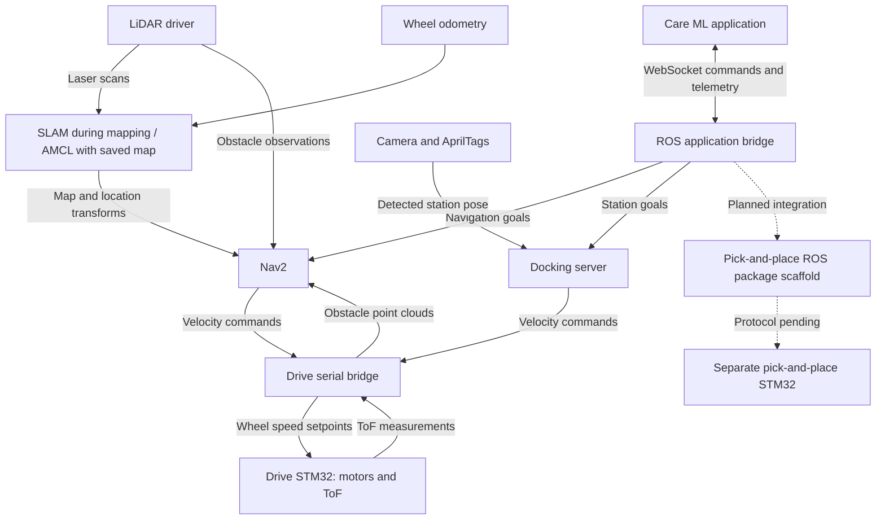

# CareBot


CareBot is the ROS 2 robot workspace for **CareRobotics**, connecting navigation,
sensing, station docking, and application commands with the robot's embedded
controllers. The system is being developed to support supply delivery and
pick-and-place workflows.

The company introduction will be aligned with the existing CareRobotics project
README when that reference is available.

## What this repository contains

This workspace contains the robot-side software. Care ML communicates with it
through a WebSocket bridge to request navigation and receive telemetry. The
separate Care ML application and STM32 firmware have not yet been imported here.

The immediate development priority is navigation: establish reliable localization,
obstacle detection, and goal execution before connecting the full delivery workflow.

## How the system fits together



Solid connections describe the implemented software paths and intended sensor
inputs; physical hardware readiness must be verified separately. Dashed connections
are reserved for future integration.

### Navigation and sensing

- **LiDAR** supplies scans for mapping, localization and obstacle detection.
- **SLAM** builds a map while estimating the robot's location. With a saved map,
  the current navigation launch uses map server and **AMCL** by default.
- **Wheel odometry** estimates movement from measured wheel rotation. Gazebo
  supplies simulated odometry; physical encoder feedback and ROS odometry still
  need integrating.
- **ToF sensors** on the drive STM32 supply local obstacle measurements. The
  serial bridge publishes these as point clouds for the Nav2 costmaps.
- **AprilTags** identify stations and provide relative station poses for precise
  docking. The current tag path does not implement general localization correction.

Coordinate transforms connect the map, odometry, robot body, and sensor frames so
ROS can interpret each observation in the appropriate location.

### Two separate embedded controllers

| Controller | Responsibility | ROS integration |
|---|---|---|
| Drive STM32 | Drive motors and ToF sensors | `care_hw_bridge` combined serial RX/TX node |
| Pick-and-place STM32 | Separate manipulator program | `care_pick_place_bridge` scaffold only |

Each controller needs its own device connection. Prefer stable
`/dev/serial/by-id/` paths. Only one process should own each serial port.

Navigation success means arrival; docking success means alignment. Neither result
currently confirms that loading or delivery has completed. A mission workflow must
connect those steps to manipulator feedback and delivery confirmation.

## Workspace layout

| Location | Purpose |
|---|---|
| `src/care_app/` | Care ML WebSocket bridge and robot telemetry |
| `src/care_navigation/` | Nav2, Gazebo, mapping, localization and docking configuration |
| `src/care_bridge/` | Drive and ToF serial bridges |
| `src/care_manipulation/` | Empty C++ pick-and-place integration package |
| `src/care_description/` | Robot URDF, meshes and sensor mounting frames |
| `src/care_april_tag_detection/` | Camera calibration and tag detection scripts |
| `src/care_mock/` | Mock navigation and inventory for application integration |
| `src/care_interfaces/` | Shared ROS interface scaffold |
| `src/care_perception/`, `src/care_localization/` | Additional package scaffolds |
| `src/care_bringup/` | Top-level bringup scaffold |
| `src/opennav_docking/` | Empty reserved directory; docking dependency must be supplied |

See [workspace structure](docs/PROJECT_STRUCTURE.md) for the detailed responsibilities
and current implementation boundaries. Future embedded source should be imported
under `firmware/drive/` and `firmware/pick_place/`, preserving upstream build files
and licenses.

## Development environment

The workspace targets **ROS 2 Humble on Ubuntu 22.04**. The Dockerfile in `docker/standard/` provides
a ROS desktop base image, and VS Code Dev Containers selects the `carerobot_dev`
Compose service.

1. Start Docker Desktop and enable WSL integration if working from WSL.
2. Install the VS Code Dev Containers extension.
3. Open the repository and select **Dev Containers: Reopen in Container**.
4. Use the container terminal at `/workspace`.

The repository is bind-mounted at `/workspace`, so source changes survive rebuilds.
Manually installed tools elsewhere in the container may not. VS Code automatically
installs extensions listed in `.devcontainer/devcontainer.json`.

The optional user Compose override supplies host-specific ML configuration and
reference mounts; the shared Compose file contains no personal host paths. The current image does not yet
install every navigation, camera, or Python application dependency. The navigation
launch requires `opennav_docking`; its reserved source directory is currently empty.

### Build

With package dependencies installed:

```bash
source /opt/ros/humble/setup.bash
colcon build --symlink-install
source install/setup.bash
```

To check only the empty manipulator scaffold:

```bash
colcon build --packages-select care_pick_place_bridge
```

### Development workflows

Run the relevant workflow after building and sourcing the workspace:

```bash
# Mock navigation and inventory with the ML WebSocket bridge
ros2 launch mock_nav2_server mock_and_bridge.launch.py

# Gazebo navigation with a saved map and AMCL
ros2 launch care_navigation care_nav2.launch.py

# Teleoperation and SLAM mapping in Gazebo
ros2 launch care_navigation care_bot_teleop_mapping.launch.py

# Drive STM32 serial bridge on the computer connected to the controller
ros2 launch care_hw_bridge stm32_serial_bridge.launch.py \
  serial_port:=/dev/serial/by-id/YOUR_DRIVE_CONTROLLER
```

These are separate workflows, not a unified production bringup. Set the initial
pose for saved-map navigation. Measured station poses must replace the placeholder
values in `src/care_navigation/config/docks.yaml` before physical docking.

### Codex and Claude configuration

The [user Compose override](docker/user/docker-compose.yml) shares WSL Codex and
Claude instructions, skills and configuration. Copy
[the environment template](docker/user/.env.example) to `docker/user/.env` and
configure your existing host paths. It also exposes the previous CareRobotics
README and assets at `/care_reference`.

The mounts do not install CLI tools or extensions. AI mounts are writable and
share state with WSL. Follow [Docker setup](docker/README.md) for startup and
[development notes](docs/DEVELOPMENT.md) for rebuild behavior.

## Current status and next steps

1. Verify navigation independently: scans, odometry, transforms, costmaps and goals.
2. Integrate physical LiDAR and encoder feedback, then validate the drive controller.
3. Validate AprilTag docking with measured station positions and calibrated cameras.
4. Import the separate pick-and-place controller source and define its ROS contract.
5. Connect loading, navigation, docking, manipulation and confirmation into a mission.
6. Make container dependencies, mounts and hardware startup reproducible.

The pick-and-place package intentionally contains no runtime code. Additional
perception, localization, interface and bringup packages are scaffolds rather than
completed subsystems.

## CareBot repository transition

This workspace is being prepared for a new GitHub repository named **CareBot**.
The configured destination is [nikhilr2907/CareBot](https://github.com/nikhilr2907/CareBot).
Create that repository on GitHub before pushing. Existing ROS package names are retained so current
launch commands and package references continue to resolve.

## Contact

For CareBot development and project enquiries, contact
[nikhilr2907 on GitHub](https://github.com/nikhilr2907).
