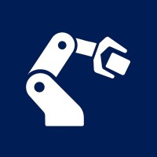
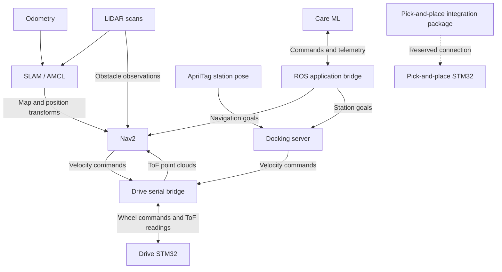

  

# CareBot

> **Work in progress:** CareBot is under active development. This repository brings together navigation, sensing, docking, and embedded controller integration for CareRobotics’ hospital replenishment robot.

Website: [thecarerobotics.com](https://www.thecarerobotics.com/)

CareRobotics is building the automation layer that gives hospital staff their
time back. Searching for supplies and equipment takes time away from care, and
missing stock delays treatment. The company is developing robots to restock wards
and handle replenishment logistics. CareRobotics is supported by Imperial College
London and UCL through the Imperial VCC Accelerator and the UCL Venture Builder.
A full-size prototype is in development, with a hospital pilot under discussion
with HCA UK.

This repository holds the ROS 2 robot software for CareBot: navigation, sensing,
station docking and communication with the embedded controllers. Task allocation
and fleet orchestration live in [CareAI](https://github.com/nikhilr2907/CareAI),
which communicates with this workspace through the
[Care ML WebSocket bridge](src/care_app/care_ml_websocket_bridge/).

## Overview

Care ML communicates with the ROS application bridge over WebSocket. The bridge
submits navigation and docking goals and returns robot state, task feedback,
and inventory telemetry.

The robot has two separate STM32 controllers: one for the drive motors and ToF
sensors, and another running the pick-and-place program. The drive serial bridge
converts ROS velocity commands into wheel speed setpoints and publishes incoming
ToF measurements as obstacle point clouds. The pick-and-place ROS package reserves
the integration boundary for the second controller.

## Architecture

## Navigation and sensing

| Component | Role |
|---|---|
| LiDAR | Scan input for mapping, localization and obstacle detection |
| SLAM | Builds a map and estimates the robot’s location during mapping |
| AMCL | Localizes the robot against a saved map |
| Odometry | Estimates movement; Gazebo provides it in simulation |
| ToF sensors | Provide local obstacle measurements to Nav2 costmaps |
| AprilTags | Provide station poses for precise docking |

ROS coordinate transforms relate the map, odometry, robot body and sensor frames.
The navigation package includes Gazebo, SLAM mapping, saved-map localization,
Nav2 configuration and docking configuration.

## Repository layout

| Location | Purpose |
|---|---|
| `src/care_app/` | Care ML WebSocket bridge and robot telemetry |
| `src/care_navigation/` | Navigation, mapping, localization and docking configuration |
| `src/care_bridge/` | Drive and ToF serial bridges |
| `firmware/pick_place/` | STM32 and ESP32 controller source and host control tools |
| `src/care_manipulation/` | C++ package scaffold for pick-and-place integration |
| `src/care_description/` | Robot URDF, meshes and sensor frames |
| `src/care_april_tag_detection/` | Camera calibration and AprilTag detection |
| `src/care_mock/` | Mock navigation and inventory |
| `src/care_interfaces/` | Shared ROS interface package scaffold |
| `src/care_perception/`, `src/care_localization/` | Perception and localization package scaffolds |
| `src/care_bringup/` | Top-level bringup package scaffold |
| `docs/` | Architecture and development documentation |
| `docker/` | Shared and user container configuration |

## Contact

For hospitals, investors and engineers, use the “Get in touch” form on
[thecarerobotics.com](https://www.thecarerobotics.com/).

For questions about this code, contact
[nikhil.raghavan25@imperial.ac.uk](mailto:nikhil.raghavan25@imperial.ac.uk)
[nikhilr2907 on GitHub](https://github.com/nikhilr2907),
[chrisbl101 on GitHub](https://github.com/chrisbl101),
or [EYang19 on GitHub](https://github.com/EYang19).

## Development

See the [development guide](docs/DEVELOPMENT.md) for environment details.
